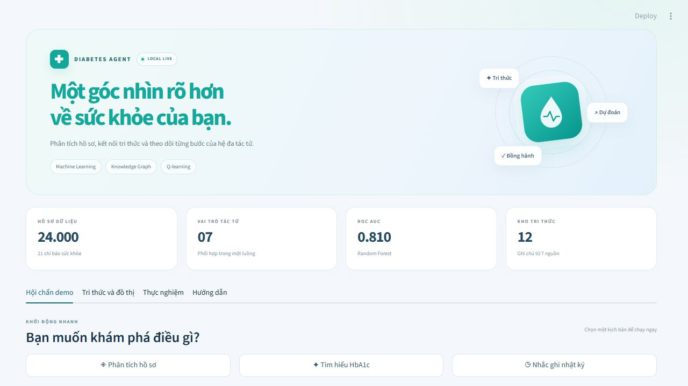
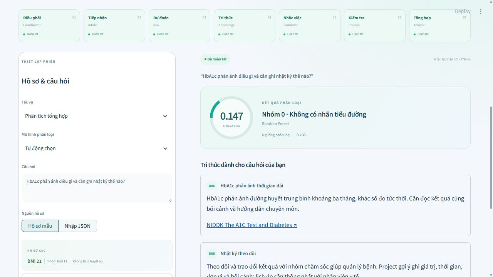

# Project01 Diabetes Agent

Ôn vấn đáp: mở [ON_TAP_VAN_DAP.html](ON_TAP_VAN_DAP.html) trực tiếp bằng trình duyệt. Trang chạy offline, có 37 câu hỏi, phần xem KB/KG/dataset/code, ví dụ dẫn chuyện và luyện nói ngẫu nhiên.

Hệ đa tác tử hỗ trợ phân loại **hồ sơ khảo sát**, truy xuất tri thức có nguồn và nhắc ghi nhật ký trong mô phỏng. Bản Project01 độc lập, kế thừa tập dữ liệu nghiên cứu đã có trong workspace và huấn luyện model mới. Không cần chạy project cũ.

Giao diện dashboard có ba kịch bản chạy nhanh, bảy thẻ trạng thái tác tử, vòng điểm phân loại, các thẻ tri thức và biểu đồ tương tác. Nhấn **Phân tích hồ sơ**, **Tìm hiểu HbA1c** hoặc **Nhắc ghi nhật ký** để chạy ngay; dùng **Bắt đầu phân tích** khi tự nhập câu hỏi và hồ sơ.





## Chạy nhanh trên Windows

Cài **Python 3.11 64-bit kèm Python launcher**, mở terminal tại thư mục này:

```powershell
py -3.11 -m venv .venv
.\.venv\Scripts\python.exe -m pip install --upgrade pip
.\.venv\Scripts\python.exe -m pip install torch==2.15.0 --index-url https://download.pytorch.org/whl/cpu
.\.venv\Scripts\python.exe -m pip install -r requirements.txt
.\.venv\Scripts\python.exe -m streamlit run app.py --server.address 127.0.0.1 --server.port 8521 --browser.gatherUsageStats false
```

Mở **http://127.0.0.1:8521**. Có thể bấm đúp `run.cmd` để tạo môi trường/cài thư viện ở lần đầu. Model, CSV và KB đi kèm nên **không cần train lại để demo**. Sau khi cài thư viện, inference không cần Internet hoặc API key. Dừng server bằng Ctrl+C.

Nếu đã có Anaconda: `conda create -n project01 python=3.11 -y`, `conda activate project01`, sau đó dùng `python -m pip ...` và `python -m streamlit ...` thay cho đường dẫn `.venv` phía trên.

## Các thành phần bàn giao

| Thư mục | Nội dung |
|---|---|
| `diabetes_agent/` | Dữ liệu, train/inference MLP và baseline, truy xuất, RL, giao thức tác tử và đánh giá |
| `notebooks/` | 4 notebook tiếng Việt, đã Run All với output thật |
| `app.py` | Demo Streamlit 4 tab, tải trace JSON |
| `data/` | CSV 24.000 dòng, provenance/checksum, 12 ghi chú và đồ thị tri thức |
| `artifacts/` | Weight/scaler, prediction từng dòng, metrics, Q-table, trace và kiểm tra |
| `report/` | PDF Project01, source LaTeX, hình và hướng dẫn biên dịch |
| `docs/` | Cách cài/chạy, kịch bản demo và đối chiếu với báo cáo tham khảo |
| `tests/` | Kiểm thử dữ liệu, hợp đồng tác tử, mô hình đã lưu và UI |

Đọc notebook theo thứ tự:

1. `01_Du_lieu_va_huan_luyen_MLP.ipynb`: kiểm tra split, SQLite, fit MLP và baseline, validation/test, nạp model.
2. `02_Tri_thuc_va_Graph_Retrieval.ipynb`: TF-IDF, khái niệm/cạnh, nguồn và 24 câu đánh giá.
3. `03_Q_learning_nhac_nhat_ky.ipynb`: MDP, train 5 seed, đối chứng, đọc Q-table.
4. `04_Tich_hop_Multi_Agent_va_Demo.ipynb`: hội chẩn, trace, dữ liệu thiếu, cảnh báo và Council.

Mở notebook bằng `.\.venv\Scripts\python.exe -m notebook` rồi chọn kernel của môi trường vừa cài. Nếu kernel khác môi trường, đăng ký bằng `.\.venv\Scripts\python.exe -m ipykernel install --user --name project01 --display-name "Project01 Python 3.11"` và chọn tên đó. Cell setup in phiên bản Python. Mã thuật toán đặt trong module dùng chung để notebook và demo chạy cùng implementation.

## Tái lập bằng lệnh

```powershell
.\.venv\Scripts\python.exe scripts/run_experiments.py
.\.venv\Scripts\python.exe scripts/execute_notebooks.py
.\.venv\Scripts\python.exe -m pytest -q --junitxml=artifacts/test-results.xml
```

`run_experiments.py` có `--stage models|rl|evaluation` để chạy riêng. `execute_notebooks.py` dùng đúng Python gọi script, chạy tuần tự và lưu output trực tiếp vào ipynb; notebook 01/03 huấn luyện lại nên thay artifact bằng kết quả mới. Không mở đồng thời quá trình huấn luyện và demo nếu muốn tránh đọc artifact trong lúc ghi. Thời gian máy kiểm tra khoảng một phút cho bốn notebook, có thể khác trên máy khác.

**Quy tắc đánh giá:** scaler fit train; early stopping và chọn model/ngưỡng chỉ xem validation; test dùng để báo cáo sau khi khóa lựa chọn. Mặc định chọn bằng Average Precision validation. Không đổi mặc định theo model đạt điểm test cao nhất. Split và SHA256 nằm trong `data/provenance.json`.

## Kiến trúc và giới hạn

Coordinator điều phối 6 vai trò chuyên môn: Intake, Risk, Knowledge, Reminder, Council, Advisor. MessageBus đồng bộ trong một tiến trình, có REQUEST/INFORM/FAILURE, dừng hữu hạn và vết thời gian. Đây không phải triển khai đầy đủ FIPA-ACL hoặc hệ phân tán.

Tri thức gồm ghi chú biên soạn ngắn từ 7 trang chính thức NIDDK/CDC, TF-IDF cộng liên kết khái niệm một bước. Câu trả lời ghép trích xuất theo mẫu; không LLM, embedding hoặc Neo4j server. `concept_graph.cypher` chỉ xuất cạnh giữa khái niệm để tham khảo.

Council kiểm tra hợp đồng và veto lỗi đã định; ID nguồn hợp lệ không bảo đảm nội dung y khoa đúng hoặc liên quan. Bộ 24 câu truy xuất, 20 kịch bản và lỗi inject do tác giả xây; điểm cao không chứng minh khả năng hội thoại tổng quát. Không kết luận đa tác tử tốt hơn một pipeline dùng cùng công cụ.

Mẫu UI thuộc train để minh họa, có thể dự đoán sai nhãn. Age là **mã nhóm 1–13**, không phải tuổi theo năm. Glucose tùy chọn chỉ dùng cho luật cảnh báo, không có trong vector CDC. Xem `data/README.md`.

Không tự lưu câu hỏi hoặc đầu vào vào database mặc định. Chỉ khi chọn lưu audit, câu hỏi/kết quả/trace ghi tại `artifacts/demo_audit.sqlite3`; câu hỏi có thể chứa nội dung bạn nhập. Không dùng hồ sơ thật trong demo lớp học.

Hướng dẫn chi tiết: `docs/HUONG_DAN_CHAY.md`; kịch bản trình diễn: `docs/KICH_BAN_DEMO.md`; phạm vi so với mẫu: `docs/DOI_CHIEU_BAO_CAO_MAU.md`.
